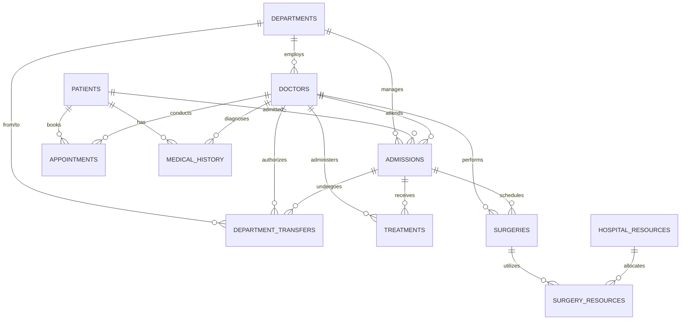

# 🏥 Hospital Management System (HMS) — DBMS Capstone Project


A comprehensive, production-grade relational database management system designed to streamline and manage hospital operations. This project models complete clinical and administrative workflows including patient admissions, appointments, doctor scheduling, medical history tracking, inter-department transfers, surgical operations, hospital inventory/resource allocation, query optimization, role-based access control (RBAC), and advanced analytical reporting.

---

## 📌 Table of Contents

- [Project Overview](#-project-overview)
- [Key Features](#-key-features)
- [Entity-Relationship (ER) Diagram](#-entity-relationship-er-diagram)
- [Database Schema Architecture](#-database-schema-architecture)
- [Database Normalization & Constraints](#-database-normalization--constraints)
- [Performance Optimization & Indexing](#-performance-optimization--indexing)
- [Views & Role-Based Access Control (RBAC)](#-views--role-based-access-control-rbac)
- [Advanced Analytical Queries & Window Functions](#-advanced-analytical-queries--window-functions)
- [Getting Started & Installation](#-getting-started--installation)
- [Database Verification & Sample Queries](#-database-verification--sample-queries)
- [Author & Acknowledgments](#-author--acknowledgments)

---

## 📖 Project Overview

Hospitals handle complex multi-entity workflows where data consistency, referential integrity, and rapid querying are mission-critical. This project addresses these requirements by implementing:

- **Full Data Normalization (3NF)**: Minimizing redundancy and update anomalies across patients, staff, and medical treatments.
- **Transactional Integrity**: Robust foreign keys with cascade and restriction safeguards.
- **Resource Tracking**: Tracking life support and surgical equipment availability with check constraints to prevent over-allocation.
- **Clinical Governance**: Tracking pre-operative safety clearances, surgery scheduling, and department transfers.
- **Optimized Execution**: Tailored B-Tree composite and covering indexes evaluated using `EXPLAIN`.
- **Security & Privilege Isolation**: Role-based access control protecting sensitive health records from unauthorized staff.

---

## ✨ Key Features

1. **Patient Admissions & Discharge Lifecycle**: Complete lifecycle management tracking admission reason, assigned ward/bed, attending doctor, and length of stay.
2. **Doctor & Department Administration**: Departmental mapping and surgeon status tracking for operating room assignments.
3. **Appointment Scheduling System**: Managing outpatient visits with status tracking (`Scheduled`, `Completed`, `Cancelled`, `No-Show`).
4. **Electronic Medical Records & Treatments**: Longitudinal diagnosis logs and continuous treatment observations.
5. **Surgeries & Operating Room (OR) Logistics**: Pre-operative safety clearance validation and resource allocation (ECG, ventilators, anesthesia machines).
6. **Inter-Department Patient Transfers**: Historical audit logging of transfers between departments with transfer justifications.
7. **Window Functions & Analytics**:
   - `DENSE_RANK()`: Ranking surgeons by procedural volume per department.
   - `AVG() OVER()`: Comparing patient lengths of stay against departmental benchmarks.
   - `LAG() OVER()`: 30-day hospital readmission surveillance.

---

## 📊 Entity-Relationship (ER) Diagram



---

## 🗄️ Database Schema Architecture

The database `hospital_management_db` contains **11 normalized tables**:

| # | Table Name | Description | Key Attributes / Foreign Keys |
|---|------------|-------------|-------------------------------|
| 1 | `Departments` | Clinical departments & facility locations | `department_id` (PK), `department_name` (UNIQUE) |
| 2 | `Patients` | Master patient demographic and contact data | `patient_id` (PK), `phone`, `email` (UNIQUE), `blood_group` |
| 3 | `Doctors` | Physician profiles, specialties, and surgeon status | `doctor_id` (PK), `department_id` (FK), `is_surgeon` |
| 4 | `Hospital_Resources` | Medical inventory, ventilators, OR equipment | `resource_id` (PK), `total_quantity`, `available_quantity` |
| 5 | `Admissions` | Inpatient stays, beds, and admission status | `admission_id` (PK), `patient_id` (FK), `doctor_id` (FK), `department_id` (FK) |
| 6 | `Appointments` | Outpatient appointments and scheduling statuses | `appointment_id` (PK), `patient_id` (FK), `doctor_id` (FK), `appointment_datetime` |
| 7 | `Medical_History` | Diagnostic history and longitudinal medical notes | `history_id` (PK), `patient_id` (FK), `doctor_id` (FK), `diagnosis_date` |
| 8 | `Treatments` | Ongoing and completed patient treatments | `treatment_id` (PK), `admission_id` (FK), `doctor_id` (FK) |
| 9 | `Department_Transfers` | Audit log of patient movement across departments | `transfer_id` (PK), `admission_id` (FK), `from_department_id` (FK), `to_department_id` (FK) |
| 10 | `Surgeries` | Scheduled surgeries, OR allocations, and clearances | `surgery_id` (PK), `admission_id` (FK), `surgeon_id` (FK), `pre_op_clearance_status` |
| 11 | `Surgery_Resources` | Bridge entity for resource allocation per surgery | `(surgery_id, resource_id)` (Composite PK), `quantity_required` |

---

## 🛡️ Database Normalization & Constraints

- **Entity Integrity**: Every table defines an explicit `PRIMARY KEY` (surrogate `AUTO_INCREMENT` or natural composite).
- **Referential Integrity**: All relationships enforce `FOREIGN KEY` constraints preventing orphaned clinical records.
- **Domain Integrity & Business Rules**:
  - `CHECK (available_quantity <= total_quantity AND available_quantity >= 0)` on hospital resources.
  - `CHECK (scheduled_end > scheduled_start)` for operating room time slots.
  - `CHECK (from_department_id <> to_department_id)` to prevent redundant transfers.
  - Controlled enumeration constraints on `admission_status`, `appointment_status`, `treatment_status`, and `pre_op_clearance_status`.

---

## ⚡ Performance Optimization & Indexing

To handle high query workloads and large analytical reporting operations, custom B-Tree indexes were designed and validated using MySQL's `EXPLAIN` execution plan analysis:

### 1. Composite Index for Patient Admission History
Optimizes timeline lookups for patient records and past admissions:
```sql
CREATE INDEX idx_admissions_patient_date
ON Admissions(patient_id, admission_date);
```

### 2. Composite Index for Doctor Appointment Schedules
Accelerates daily schedule lookups for clinicians and receptionists:
```sql
CREATE INDEX idx_appointments_doctor_datetime
ON Appointments(doctor_id, appointment_datetime);
```

### 3. Covering Index for Inpatient Reporting
Eliminates table lookups by storing all required query projection columns directly within the leaf nodes of the index:
```sql
CREATE INDEX idx_admissions_inpatient_report
ON Admissions(
    admission_status,
    patient_id,
    department_id,
    doctor_id,
    bed_number,
    admission_date,
    discharge_date
);
```

---

## 🔐 Views & Role-Based Access Control (RBAC)

In compliance with healthcare data privacy principles (e.g., HIPAA / ISO 27799), data access is partitioned between clinical and non-clinical personnel:

### 1. Current In-Patients View (`current_inpatients_view`)
Provides clinical staff with real-time occupancy and admission duration:
```sql
CREATE OR REPLACE VIEW current_inpatients_view AS
SELECT
    a.admission_id,
    p.patient_id,
    CONCAT(p.first_name, ' ', p.last_name) AS patient_name,
    d.department_name,
    a.bed_number,
    CONCAT(doc.first_name, ' ', doc.last_name) AS doctor_name,
    a.admission_date,
    DATEDIFF(CURDATE(), DATE(a.admission_date)) AS days_admitted
FROM Admissions a
JOIN Patients p ON a.patient_id = p.patient_id
JOIN Departments d ON a.department_id = d.department_id
JOIN Doctors doc ON a.doctor_id = doc.doctor_id
WHERE a.admission_status = 'Admitted' AND a.discharge_date IS NULL;
```

### 2. Restricted Front-Desk View (`front_desk_view`)
Hides sensitive diagnostic and clinical notes, exposing only appointment and contact details:
```sql
CREATE OR REPLACE VIEW front_desk_view AS
SELECT
    a.appointment_id,
    p.patient_id,
    CONCAT(p.first_name, ' ', p.last_name) AS patient_name,
    p.phone,
    a.appointment_datetime,
    CONCAT(d.first_name, ' ', d.last_name) AS doctor_name,
    dep.department_name,
    a.appointment_status
FROM Appointments a
JOIN Patients p ON a.patient_id = p.patient_id
JOIN Doctors d ON a.doctor_id = d.doctor_id
JOIN Departments dep ON d.department_id = dep.department_id;
```

### 3. Granular User Privileges
```sql
CREATE USER IF NOT EXISTS 'frontdesk_user'@'localhost' IDENTIFIED BY 'FRONTEND DESK';
GRANT SELECT ON hospital_management_db.front_desk_view TO 'frontdesk_user'@'localhost';
```

---

## 📈 Advanced Analytical Queries & Window Functions

### 1. Surgeon Performance Ranking (`DENSE_RANK()`)
Ranks surgeons based on completed/scheduled surgeries partitioned by their respective departments:
```sql
SELECT
    dep.department_name,
    CONCAT(doc.first_name, ' ', doc.last_name) AS surgeon_name,
    COUNT(s.surgery_id) AS total_surgeries,
    DENSE_RANK() OVER (
        PARTITION BY dep.department_id
        ORDER BY COUNT(s.surgery_id) DESC
    ) AS surgeon_rank
FROM Doctors doc
JOIN Departments dep ON doc.department_id = dep.department_id
LEFT JOIN Surgeries s ON doc.doctor_id = s.surgeon_id
WHERE doc.is_surgeon = TRUE
GROUP BY dep.department_id, dep.department_name, doc.doctor_id, doc.first_name, doc.last_name
ORDER BY dep.department_name, surgeon_rank;
```

### 2. Departmental Stay Benchmark (`AVG() OVER()`)
Compares each patient's duration of stay against the department average to spot anomalies:
```sql
SELECT
    admission_id,
    patient_name,
    department_name,
    days_admitted,
    ROUND(AVG(days_admitted) OVER (PARTITION BY department_id), 2) AS department_avg_days,
    CASE
        WHEN days_admitted > AVG(days_admitted) OVER (PARTITION BY department_id) THEN 'Above Department Average'
        WHEN days_admitted < AVG(days_admitted) OVER (PARTITION BY department_id) THEN 'Below Department Average'
        ELSE 'Equal to Department Average'
    END AS stay_comparison
FROM (
    SELECT
        a.admission_id,
        CONCAT(p.first_name, ' ', p.last_name) AS patient_name,
        d.department_id,
        d.department_name,
        DATEDIFF(COALESCE(DATE(a.discharge_date), CURDATE()), DATE(a.admission_date)) AS days_admitted
    FROM Admissions a
    JOIN Patients p ON a.patient_id = p.patient_id
    JOIN Departments d ON a.department_id = d.department_id
) AS patient_stays
ORDER BY department_name, admission_id;
```

### 3. Readmission Detection Within 30 Days (`LAG()`)
Monitors readmission rates using Common Table Expressions (CTE) and window offsets:
```sql
WITH admission_history AS (
    SELECT
        patient_id,
        admission_id,
        DATE(admission_date) AS admission_date,
        DATE(discharge_date) AS discharge_date,
        LAG(DATE(discharge_date)) OVER (
            PARTITION BY patient_id
            ORDER BY admission_date
        ) AS previous_discharge_date
    FROM Admissions
)
SELECT
    patient_id,
    admission_id,
    previous_discharge_date,
    admission_date,
    DATEDIFF(admission_date, previous_discharge_date) AS days_between_readmission,
    'Readmitted Within 30 Days' AS readmission_status
FROM admission_history
WHERE previous_discharge_date IS NOT NULL
AND DATEDIFF(admission_date, previous_discharge_date) BETWEEN 0 AND 30;
```

---

## 🚀 Getting Started & Installation

### Prerequisites
- [MySQL Server 8.0+](https://dev.mysql.com/downloads/mysql/) or compatible RDBMS (MariaDB 10.5+)
- [MySQL Workbench](https://www.mysql.com/products/workbench/), [DBeaver](https://dbeaver.io/), or MySQL Command Line Client
- [Git](https://git-scm.com/)

### Step-by-Step Setup

1. **Clone the Repository**:
   ```bash
   git clone https://github.com/ayeshsrivastava/DBMS-CAPSTONE-PROJECT-HOSPITAL-MANAGEMENT-SYSTEM.git
   cd DBMS-CAPSTONE-PROJECT-HOSPITAL-MANAGEMENT-SYSTEM
   ```

2. **Execute the SQL Script**:
   Using the MySQL Command-Line Client:
   ```bash
   mysql -u root -p < Hospital_Management_System.sql
   ```

   *Alternatively, open `Hospital_Management_System.sql` in MySQL Workbench or DBeaver and run the script (Execute All).*

3. **Verify Database Deployment**:
   ```sql
   USE hospital_management_db;
   SHOW TABLES;
   ```

---

## 🔍 Database Verification & Sample Queries

The SQL script includes automated verification blocks to validate record counts and integrity:

```sql
SELECT
    (SELECT COUNT(*) FROM Departments) AS Departments,
    (SELECT COUNT(*) FROM Patients) AS Patients,
    (SELECT COUNT(*) FROM Doctors) AS Doctors,
    (SELECT COUNT(*) FROM Hospital_Resources) AS Resources,
    (SELECT COUNT(*) FROM Admissions) AS Admissions,
    (SELECT COUNT(*) FROM Appointments) AS Appointments,
    (SELECT COUNT(*) FROM Medical_History) AS Medical_History,
    (SELECT COUNT(*) FROM Treatments) AS Treatments,
    (SELECT COUNT(*) FROM Department_Transfers) AS Transfers,
    (SELECT COUNT(*) FROM Surgeries) AS Surgeries,
    (SELECT COUNT(*) FROM Surgery_Resources) AS Surgery_Resources;
```

---

## 👨‍💻 Author & Repository

- **Author**: [Ayesh Srivastava](https://github.com/ayeshsrivastava)
- **Repository**: [DBMS-CAPSTONE-PROJECT-HOSPITAL-MANAGEMENT-SYSTEM](https://github.com/ayeshsrivastava/DBMS-CAPSTONE-PROJECT-HOSPITAL-MANAGEMENT-SYSTEM)

---

## 📄 License

This project is licensed under the [MIT License](LICENSE).
